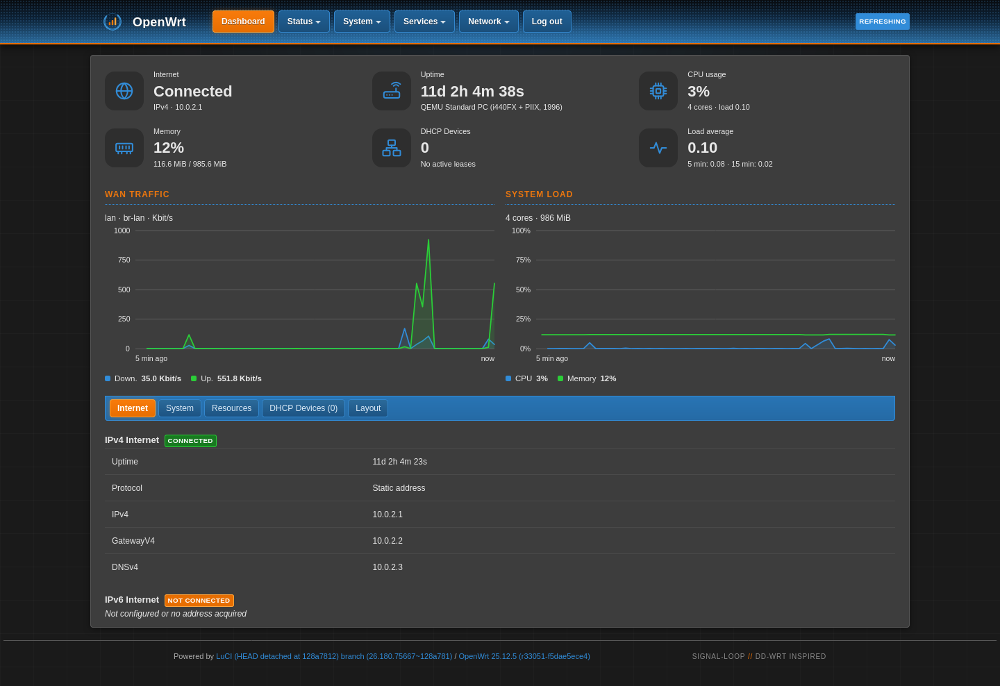
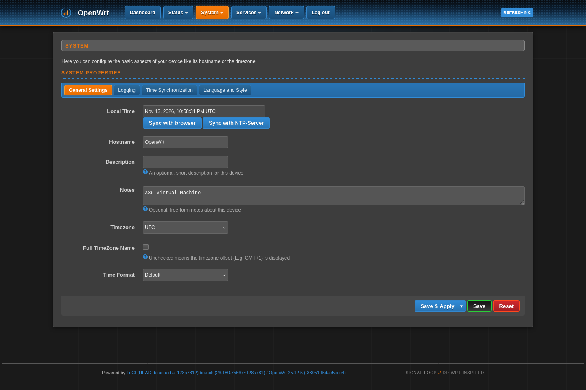
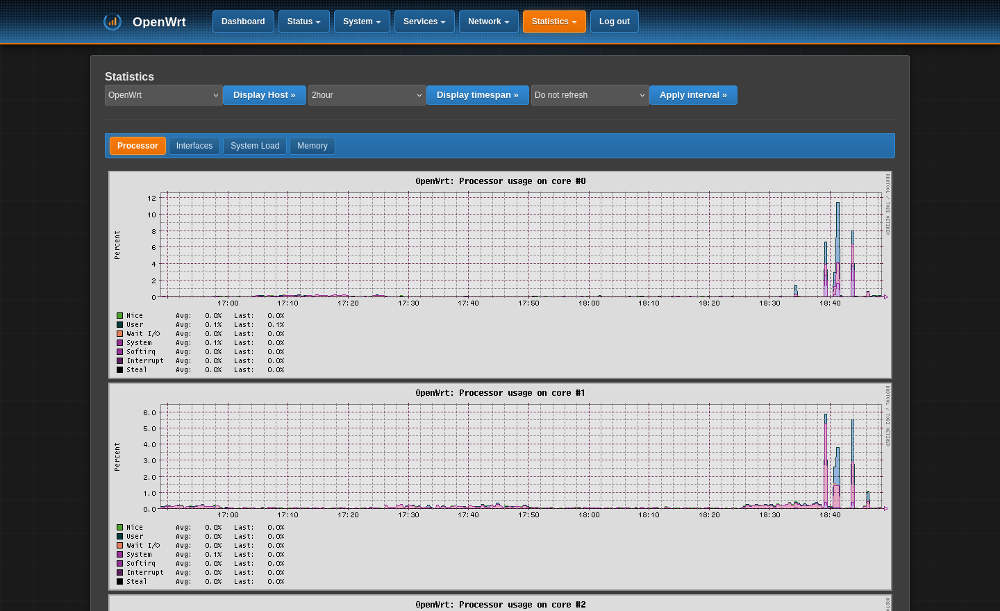
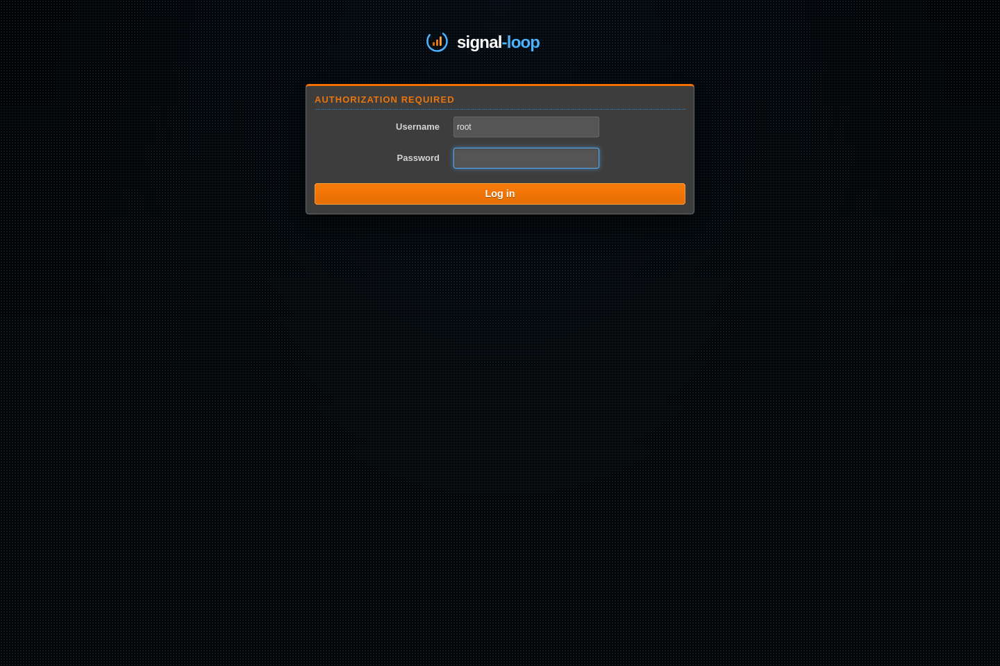
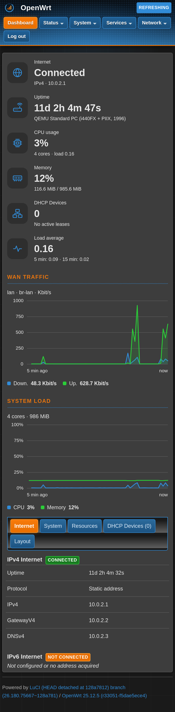
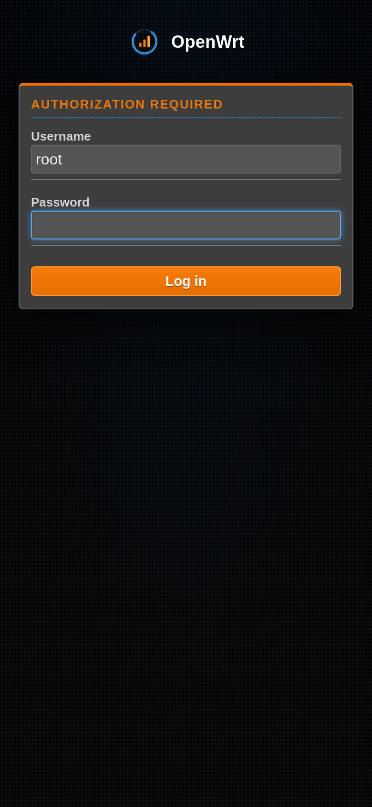
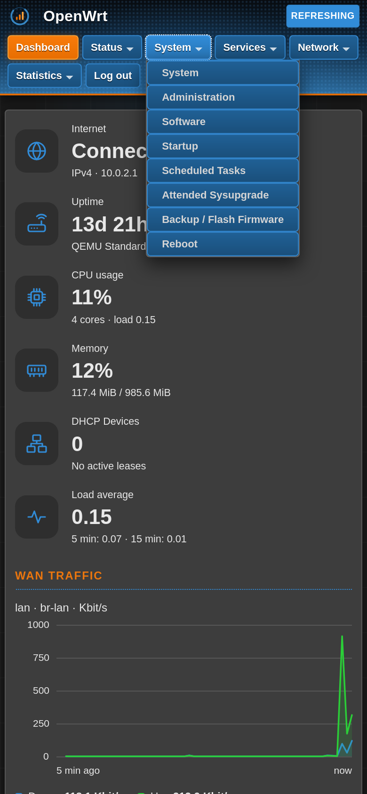

# luci-theme-signal-loop

A dark LuCI theme for **OpenWrt** built on the official **Bootstrap** theme and
styled after the DD-WRT web interface:

* charcoal panels (`#1a1a1a` / `#3d3d3d` / `#474747` / `#5a5a5a`)
* steel-blue gradient navigation and buttons (`#318cd8` → `#1c5382`)
* orange highlights and active states (`#f87b0b` → `#e76e01`)
* compact Verdana typography with small uppercase status labels
* DD-WRT style bars, tabs, tables and a dotted "signal" header field

The complete official LuCI Bootstrap stylesheet is kept intact and the
DD-WRT skin is layered on top of it. Every stock LuCI view, CBI widget and
optional module therefore keeps working without markup changes.

The theme is dark-only (`data-darkmode="true"`), matching the DD-WRT web
interface.

## Screenshots

**Status overview**



**Tabbed settings** (active tab highlighted in orange)



**Statistics graphs** (light chart canvas)



**Login**



**Mobile**

| Dashboard | Login |
| --- | --- |
|  |  |

**Mobile navigation** (a tap opens the menu without following the first entry)



## Layout

| Element | Description |
| --- | --- |
| Header | Dotted signal field with the router hostname, the Signal Loop icon and steel-blue mode buttons; the current mode is orange |
| Dropdowns | Steel-blue submenus with orange active entries |
| Content | Charcoal card with DD-WRT style section headers and dotted rules |
| Tab bar | Blue submenu bar with rounded tab pills and an orange active tab |
| Forms | Compact Verdana inputs, blue focus rings, DD-WRT style action bar |
| Statistics | `rrdtool` charts get a light-gray canvas while keeping their series colours |
| Footer | LuCI / distribution credits plus the theme credit and mode menu |
| Login | Centered charcoal dialog with the router hostname and Signal Loop icon above it |

## Requirements

* OpenWrt 24.10 or newer with LuCI (`luci-base`)
* A LuCI build that renders `ucode` templates (all recent releases)

## Installation

### From a packaged release

Install the `.apk` (OpenWrt 25.12+) or `.ipk` (older releases) produced by the
CI workflow, then select the theme under **System → System → Language and
Style** or set it directly:

```sh
uci set luci.themes.SignalLoop=/luci-static/signal-loop
uci set luci.main.mediaurlbase=/luci-static/signal-loop
uci commit luci
```

On a fresh install the theme is selected automatically. On upgrade the
previously selected theme is preserved.

### Building into an OpenWrt tree / SDK

Add the repository as a local feed and build the package:

```sh
# inside your OpenWrt or SDK checkout
echo "src-link signal-loop /path/to/luci-theme-signal-loop" >> feeds.conf.default
./scripts/feeds update signal-loop
./scripts/feeds install -f luci-theme-signal-loop

make menuconfig   # LuCI → Themes → luci-theme-signal-loop
make package/luci-theme-signal-loop/compile V=s
```

The package is written to `bin/packages/<arch>/signal-loop/`.

## Repository layout

```
themes/luci-theme-signal-loop/
├── Makefile                                   # OpenWrt package definition
├── htdocs/luci-static/signal-loop/            # CSS, logo and favicon assets
├── htdocs/luci-static/resources/              # menu and login renderers
├── root/etc/uci-defaults/                     # first-boot theme registration
└── ucode/template/themes/signal-loop/         # header / footer / login templates
```

## Development

The skin lives in
`themes/luci-theme-signal-loop/htdocs/luci-static/signal-loop/cascade.css`.
The first part of the file is the unmodified official Bootstrap stylesheet;
the DD-WRT skin starts at the `Signal Loop skin` comment. Design tokens are
declared in the `:root` block at the beginning of that section, so changing
them re-themes most of the interface.

`mobile.css` is loaded on screens up to 854 device pixels wide and contains
the responsive header, table and form refinements.

Optional views such as `luci-mod-dashboard` pick up the palette through the
standard LuCI variables (`--background-color-medium`, `--text-color-high`,
`--border-color-medium`, `--primary-color-high`, …) and the `data-darkmode`
attribute.

`icon.svg` provides the Signal Loop mark used by the header and login brand,
`logo.svg` is the standalone wordmark, and the favicons share the same
artwork; the PNG/ICO files are only rasterized copies for browsers and
operating systems that do not use the SVG icons.

## Credits

* Layout and scaffolding derived from
  [`luci-theme-bootstrap`](https://git.openwrt.org/?p=project/luci.git)
  by Steven Barth, Jo‑Philipp Wich and David Menting (Apache‑2.0).
* Visual language inspired by [DD-WRT](https://dd-wrt.com/).

## License

Apache License 2.0 — see [LICENSE](LICENSE).
